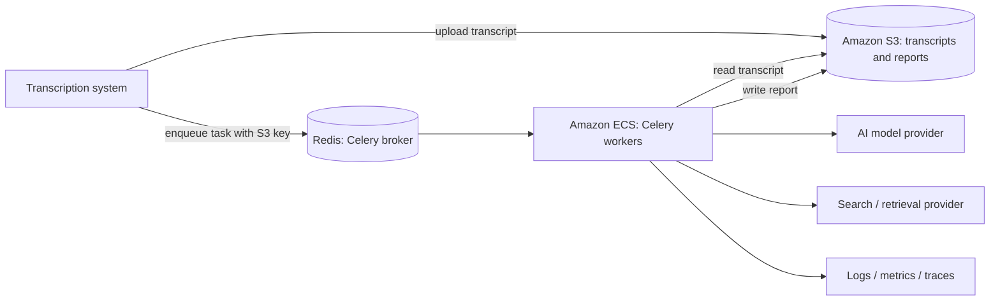

# Proposed deployment strategy

## Architecture
This solution is built around an imagined version of the organization's infrastructure to show how we might integrate this service. There are some assumptions made here about cloud provider, how trasncripts are generated and how they arrive in s3, etc.

- **Transcription system:** In the company's infrastructure, uploads a transcript to S3, then enqueues a Celery task with its S3 key.
- **S3:** Holds transcripts and reports. Workers read transcripts and write reports. The mock/ folder here in the repo is meant to mock potential prefix structure of this bucket: `{show_name}/{episode_id}/transcript.json`
- **Redis broker:** Holds Celery tasks until workers pick them up.
- **ECS workers:** Run the containerized Celery worker and generate show notes and claim-verification reports. ECS orchestrates the worker containers.
- **AI model provider:** Generates structured outputs for the analysis; the vendor is not fixed by this design. In this particular implementation, I'm using OpenAI but it could be swapped out for another provider.
- **Search / retrieval provider:** Supplies attributable evidence for claim verification; the vendor is not fixed by this design. In this particular implementation, I'm using Tavily.
- **Logs / metrics / traces:** Receive worker telemetry through the company's observability stack; no monitoring vendor is assumed.

## Operations and non-functional requirements

- **Deployment:** Build and check the container in CI, then deploy a versioned image to ECS.
- **Security:** Transcripts and reports may contain sensitive material, so I'd limit S3 and broker access to the systems that need it and keep provider credentials out of the image and source code. We'd need to decide what transcript content can be sent to model and search providers, and what those providers retain. I'd encrypt data in transit and at rest, keep transcript bodies and credentials out of logs and traces, and set access and retention policies for stored data and telemetry.
- **Scaling:** I'm making an assumption that these jobs are not time-critical, so some queueing is acceptable. It's possible to set up a policy to scale ECS workers against Celery queue depth if volume grows, while capping worker count and per-worker concurrency. Each current worker processes one episode at a time, though claim checks fan out within an episode.
- **Cost:** LLM inference is likely the main cost driver. We fan out claim checks into focused tasks because smaller models may handle them well; I did some back-of-the-envelope estimates suggesting concurrent Luna calls could cost similar or less than a single larger-model pass over all facts, but this remains a bit of an open question. Current model choices and reasoning levels are reasonable defaults, not an optimized configuration. I would evaluate model and reasoning-level combinations on representative episodes, then compare report quality, latency and cost per episode before selecting a production setup.
- **Fault tolerance:** There are two places a job could fail: the transcription system might upload a transcript but fail to enqueue it, or the worker might fail during analysis. I'd have the transcription system retry a failed enqueue, and make worker failures visible rather than retrying everything automatically. If we add retries for temporary provider errors, we'd need to make sure a rerun can't overwrite a report for a newer transcript.
- **Observability and quality:** I'd use episode and task IDs to connect logs, traces and reports, and watch queue age, failures and cost per episode. Langsmith provides detailed, quality traces that can also be exported via opentelemetry so that they can integrate with existing observability systems. Online evaluation for quality can be run on traces, and traces can be collected as goldens for offline evaluation.
