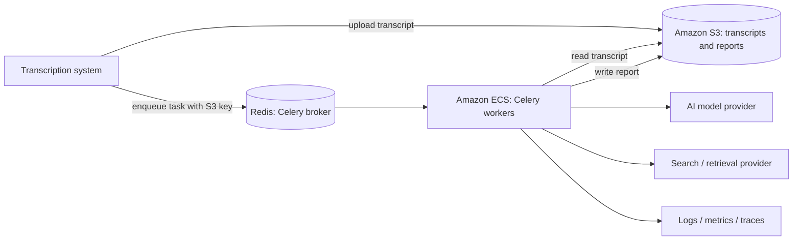

# Proposed deployment strategy

## Architecture
This solution is built around an imagined version of the organization's infrastructure to show how we might integrate this service. There are assumptions here about the cloud provider, how transcripts are generated, and how they arrive in S3. The current implementation uses local files under `mock/`; S3 and ECS integration are proposed, not implemented.

- **Transcription system:** In the company's infrastructure, uploads a transcript to S3, then enqueues a Celery task with its S3 key.
- **S3:** Holds transcripts and reports. Workers read transcripts and write reports. The mock/ folder here in the repo is meant to mock potential prefix structure of this bucket: `{show_name}/{episode_id}/transcript.json`
- **Redis broker:** Holds Celery tasks until workers pick them up.
- **ECS workers:** Run the containerized Celery worker. Each task invokes one synchronous agent that reads the transcript, researches claims, and produces the complete report. ECS orchestrates the worker containers.
- **AI model provider:** OpenAI powers the agent's reasoning, search-tool calls, and structured report output. The report uses one Pydantic schema throughout generation, validation, and storage. Changing providers would require checking tool-calling, structured-output, and tracing support.
- **Search / retrieval provider:** Supplies attributable evidence for claim verification; the vendor is not fixed by this design. In this particular implementation, I'm using Tavily.
- **Logs / metrics / traces:** Receive worker telemetry through the company's observability stack; no monitoring vendor is assumed.

## Operations and non-functional requirements

- **Deployment:** Build and check the container in CI, then deploy a versioned image to ECS.
- **Security:** Transcripts and reports may contain sensitive material, so I'd limit S3 and broker access to the systems that need it and keep provider credentials out of the image and source code. We'd need to decide what transcript content can be sent to model and search providers, and what those providers retain. I'd encrypt data in transit and at rest and set access and retention policies for stored data and telemetry. Current traces include model inputs, outputs, and search results; redaction and appropriate trace access controls are required before handling sensitive transcripts. Validation exceptions can also contain transcript excerpts, so production log handling needs the same review.
- **Scaling:** I'm assuming these jobs are not time-critical, so some queueing is acceptable. ECS workers could scale against Celery queue depth, with caps on worker count and per-worker concurrency. Each current worker processes one episode at a time; concurrency between episodes belongs to Celery, not application-managed claim workers.
- **Cost:** Worker infrastructure cost depends on volume and throughput. LLM inference is likely the bigger cost concern. `gpt-6-sol` is a starting point, not a production model selection. I briefly tried fanning out focused tasks to smaller models, but that didn't necessarily show clear cost savings. In a real-world scenario, I'd put together offline evaluations, then test smaller models, reasoning levels, and few-shot prompting against report quality and cost in order to select an appropriate model for the task that balances cost and performance.
- **Fault tolerance:** A transcript upload could succeed while enqueueing fails, or a worker could fail during analysis. I'd have the transcription system retry failed enqueueing. Currently, transcript and source-reference validation errors receive one correction attempt with the existing conversation; provider schema parse errors, persistent reference failures, an exhausted model-call budget, and model-provider failures propagate to Celery. Search failures are logged with details while the agent receives a generic error and can continue with available evidence. Tasks are not automatically retried. The report is written atomically only after successful validation. Production retries would need to prevent a rerun from overwriting a report for a newer transcript.
- **Observability and quality:** Task logs record start, completion, correction attempts, failures, and provider-returned reasoning summaries when available. LangSmith traces capture episode analysis, model and search calls, and reasoning summaries; they can also be exported through OpenTelemetry. Task IDs are attached to agent trace metadata. I'd monitor queue age, failures, latency, and cost per episode. Evaluations may measure missed claims, verdict accuracy, source relevance, and fidelity of the notes to the episode. Traces can be used to build datasets for offline evaluation as well.
